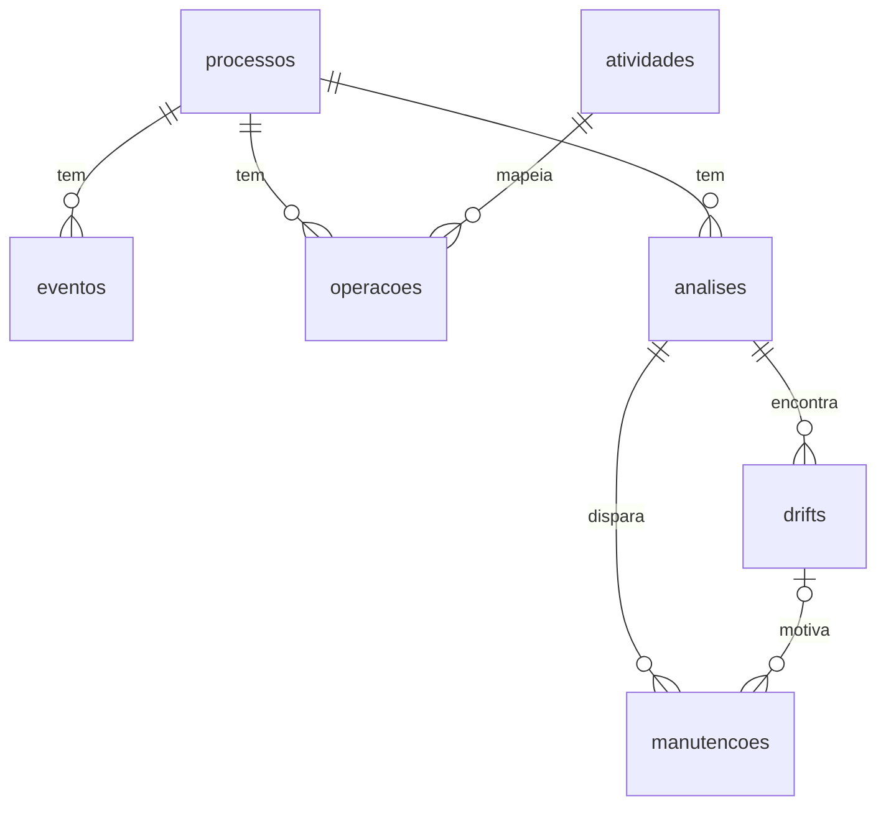

# Classes e tabelas

Links fixos no commit `dfa0e7f`.

## 1. As 13 classes de domínio

Todas em `backend/driftor/dominio.py`. O link ao lado do nome abre a linha da classe.

| Classe | Atributos | Métodos |
|---|---|---|
| `Processo` [`dominio.py:33`](https://github.com/aland3r/driftor-reuso/blob/dfa0e7f/backend/driftor/dominio.py#L33) | nome, status, arquivo, formato, total_traces, total_eventos | `criar`, `renomear`, `carregar_log`, `marcar_pronto`, `pode_analisar` |
| `Evento` [`dominio.py:76`](https://github.com/aland3r/driftor-reuso/blob/dfa0e7f/backend/driftor/dominio.py#L76) | rotulo, inicio, duracao_s, atividade | `nome_no_grafo` |
| `Trace` [`dominio.py:87`](https://github.com/aland3r/driftor-reuso/blob/dfa0e7f/backend/driftor/dominio.py#L87) | case_id, eventos | `inicio`, `sequencia`, `duracao` |
| `Atividade` [`dominio.py:110`](https://github.com/aland3r/driftor-reuso/blob/dfa0e7f/backend/driftor/dominio.py#L110) | nome, descricao | `criar`, `editar` |
| `Operacao` [`dominio.py:131`](https://github.com/aland3r/driftor-reuso/blob/dfa0e7f/backend/driftor/dominio.py#L131) | rotulo, ocorrencias, casos, atividade | `contar`, `sugerir_atividade`, `mapear` |
| `Variante` [`dominio.py:170`](https://github.com/aland3r/driftor-reuso/blob/dfa0e7f/backend/driftor/dominio.py#L170) | numero, sequencia, total_traces | `agrupar`, `descricao` |
| `No` [`dominio.py:192`](https://github.com/aland3r/driftor-reuso/blob/dfa0e7f/backend/driftor/dominio.py#L192) | atividade, frequencia, duracao_media_s | `rotulo` |
| `Aresta` [`dominio.py:202`](https://github.com/aland3r/driftor-reuso/blob/dfa0e7f/backend/driftor/dominio.py#L202) | origem, destino, frequencia | (só dados) |
| `Grafo` [`dominio.py:209`](https://github.com/aland3r/driftor-reuso/blob/dfa0e7f/backend/driftor/dominio.py#L209) | nos, arestas | `montar`, `para_mermaid` |
| `PontoDaSerie` [`dominio.py:244`](https://github.com/aland3r/driftor-reuso/blob/dfa0e7f/backend/driftor/dominio.py#L244) | posicao, case_id, valor | `serie_de_duracao` |
| `Drift` [`dominio.py:263`](https://github.com/aland3r/driftor-reuso/blob/dfa0e7f/backend/driftor/dominio.py#L263) | posicao, indice, inicio_anomalia, media_antes, media_depois, variacao_pct | `aumentou`, `resumo` |
| `Analise` [`dominio.py:281`](https://github.com/aland3r/driftor-reuso/blob/dfa0e7f/backend/driftor/dominio.py#L281) | nome, atividade, delta, tratamento, total_observacoes, drifts | `criar`, `renomear`, `registrar_resultado` |
| `Manutencao` [`dominio.py:325`](https://github.com/aland3r/driftor-reuso/blob/dfa0e7f/backend/driftor/dominio.py#L325) | analise_id, drift_id, descricao, status, observacoes, concluida_em | `disparar`, `esta_pendente`, `editar`, `concluir` |


## 2. As outras classes

| Classe | Linha | Papel |
|---|---|---|
| `Configuracao` | [`config.py:29`](https://github.com/aland3r/driftor-reuso/blob/dfa0e7f/backend/driftor/config.py#L29) | Singleton com as regras dos papéis |
| `BancoDeDados` | [`banco.py:20`](https://github.com/aland3r/driftor-reuso/blob/dfa0e7f/backend/driftor/banco.py#L20) | Singleton que executa o SQL |
| `RepositorioBase` | [`repositorio_base.py:18`](https://github.com/aland3r/driftor-reuso/blob/dfa0e7f/backend/driftor/repositorio_base.py#L18) | superclasse dos repositórios (compactação) |
| `RepositorioDeProcessos` | [`repositorio.py:9`](https://github.com/aland3r/driftor-reuso/blob/dfa0e7f/backend/driftor/processos/repositorio.py#L9) | SQL do Processo |
| `RepositorioDeAtividades` | [`repositorio.py:11`](https://github.com/aland3r/driftor-reuso/blob/dfa0e7f/backend/driftor/atividades/repositorio.py#L11) | SQL da Atividade |
| `RepositorioDeAnalises` | [`repositorio.py:11`](https://github.com/aland3r/driftor-reuso/blob/dfa0e7f/backend/driftor/analises/repositorio.py#L11) | SQL da Análise |
| `RepositorioDeManutencoes` | [`repositorio.py:9`](https://github.com/aland3r/driftor-reuso/blob/dfa0e7f/backend/driftor/manutencoes/repositorio.py#L9) | SQL da Manutenção |
| `Pm4pyMineradorAdapter` | [`grafo.py:18`](https://github.com/aland3r/driftor-reuso/blob/dfa0e7f/backend/driftor/mineracao/grafo.py#L18) | Adapter 1 |
| `RiverAdwinAdapter` | [`detector.py:16`](https://github.com/aland3r/driftor-reuso/blob/dfa0e7f/backend/driftor/mineracao/detector.py#L16) | Adapter 2 |
| `Sujeito`, `Observador`, `AvisoNaTela` | [`observador.py:14`](https://github.com/aland3r/driftor-reuso/blob/dfa0e7f/backend/driftor/observador.py#L14) | Observer |
| `AtualizadorDoProcesso` | [`eventos.py:15`](https://github.com/aland3r/driftor-reuso/blob/dfa0e7f/backend/driftor/analises/eventos.py#L15) | Observer da análise |

## 3. Exemplo de classe completa

📍 `backend/driftor/dominio.py` · linhas 325–364 · [abrir no GitHub](https://github.com/aland3r/driftor-reuso/blob/dfa0e7f/backend/driftor/dominio.py#L325-L364)

```python
class Manutencao:
    """Ordem de manutenção que o gestor dispara a partir de um desvio e o técnico conclui."""

    id: str
    analise_id: str
    drift_id: str | None
    descricao: str
    status: str = "pendente"       # pendente -> concluida
    observacoes: str = ""
    criado_em: datetime | None = None
    concluida_em: datetime | None = None

    @staticmethod
    def disparar(analise: Analise, drift_id: str | None, descricao: str) -> Manutencao:
        if drift_id and drift_id not in {d.id for d in analise.drifts}:
            raise ErroDeNegocio("Este desvio não pertence à análise.")
        descricao = (descricao or "").strip()
        if not descricao:
            raise ErroDeNegocio("Descreva o que o técnico deve verificar.")
        return Manutencao(novo_id(), analise.id, drift_id or None, descricao)

    def esta_pendente(self) -> bool:
        return self.status == "pendente"

    def editar(self, descricao: str) -> None:
        if not self.esta_pendente():
            raise ErroDeNegocio("Uma manutenção concluída não pode mais ser alterada.")
        descricao = (descricao or "").strip()
        if not descricao:
            raise ErroDeNegocio("A descrição não pode ficar vazia.")
        self.descricao = descricao

    def concluir(self, observacoes: str) -> None:
        if not self.esta_pendente():
            raise ErroDeNegocio("Esta manutenção já foi concluída.")
        observacoes = (observacoes or "").strip()
        if not observacoes:
            raise ErroDeNegocio("Escreva as observações do que foi feito.")
        self.status = "concluida"
        self.observacoes = observacoes
```

## 4. As 7 tabelas

Arquivo: `backend/driftor/schema.sql`. O app aplica esse arquivo ao subir (`BancoDeDados.aplicar_schema`), no schema `driftor_reuso` do Postgres (Supabase).

| Tabela | CRUD | Chaves estrangeiras |
|---|---|---|
| `processos` | Processo | |
| `eventos` | Processo (o log) | processos (cascade) |
| `atividades` | Atividade | |
| `operacoes` | Processo (mapeamento) | processo (cascade), atividade (restrict) |
| `analises` | Análise | processos (cascade) |
| `drifts` | Análise | analises (cascade) |
| `manutencoes` | Manutenção | análise (cascade), drift (set null) |



📍 `backend/driftor/schema.sql` · linhas 5–83 · [abrir no GitHub](https://github.com/aland3r/driftor-reuso/blob/dfa0e7f/backend/driftor/schema.sql#L5-L83)

```sql
create table if not exists processos (
    id            uuid primary key,
    nome          text not null,
    arquivo       text,
    formato       text,
    status        text not null default 'vazio',   -- vazio | mapeando | pronto
    total_traces  integer not null default 0,
    total_eventos integer not null default 0,
    criado_em     timestamptz not null default now(),
    atualizado_em timestamptz not null default now()
);

-- Cada linha do log de eventos carregado no processo
create table if not exists eventos (
    id          bigserial primary key,
    processo_id uuid not null references processos(id) on delete cascade,
    case_id     text not null,
    ordem       integer not null,                  -- posição do evento dentro do trace
    rotulo      text not null,                     -- nome da operação como veio no log
    inicio      timestamptz,
    duracao_s   double precision
);
create index if not exists eventos_processo on eventos(processo_id, case_id, ordem);

-- CRUD de Atividade: catálogo de atividades
create table if not exists atividades (
    id        uuid primary key,
    nome      text not null,
    descricao text not null default ''
);
create unique index if not exists atividades_nome_unico on atividades (lower(nome));

-- Liga cada operação do log a uma atividade do catálogo (mapeamento)
create table if not exists operacoes (
    processo_id  uuid not null references processos(id) on delete cascade,
    rotulo       text not null,
    ocorrencias  integer not null,
    casos        integer not null,
    atividade_id uuid references atividades(id) on delete restrict,
    primary key (processo_id, rotulo)
);

-- CRUD de Análise
create table if not exists analises (
    id                uuid primary key,
    processo_id       uuid not null references processos(id) on delete cascade,
    nome              text not null,
    atividade         text,                        -- série filtrada por uma atividade (ou o trace inteiro)
    delta             double precision not null,
    tratamento        text not null,               -- bruto | tratado
    total_observacoes integer not null,
    total_drifts      integer not null default 0,
    serie             text not null,               -- valores analisados, em JSON, para o gráfico
    criado_em         timestamptz not null default now()
);

-- Desvios que o ADWIN encontrou em cada análise
create table if not exists drifts (
    id              uuid primary key,
    analise_id      uuid not null references analises(id) on delete cascade,
    posicao         integer not null,              -- 1º, 2º, 3º desvio
    indice          integer not null,              -- trace onde o ADWIN detectou
    inicio_anomalia integer not null,              -- trace onde a mudança começou
    media_antes     double precision not null,
    media_depois    double precision not null,
    variacao_pct    double precision not null
);

-- CRUD de Manutenção: o gestor dispara a partir de um desvio, o técnico conclui
create table if not exists manutencoes (
    id           uuid primary key,
    analise_id   uuid not null references analises(id) on delete cascade,
    drift_id     uuid references drifts(id) on delete set null,
    descricao    text not null,
    status       text not null default 'pendente',   -- pendente | concluida
    observacoes  text not null default '',
    criado_em    timestamptz not null default now(),
    concluida_em timestamptz
);
```
