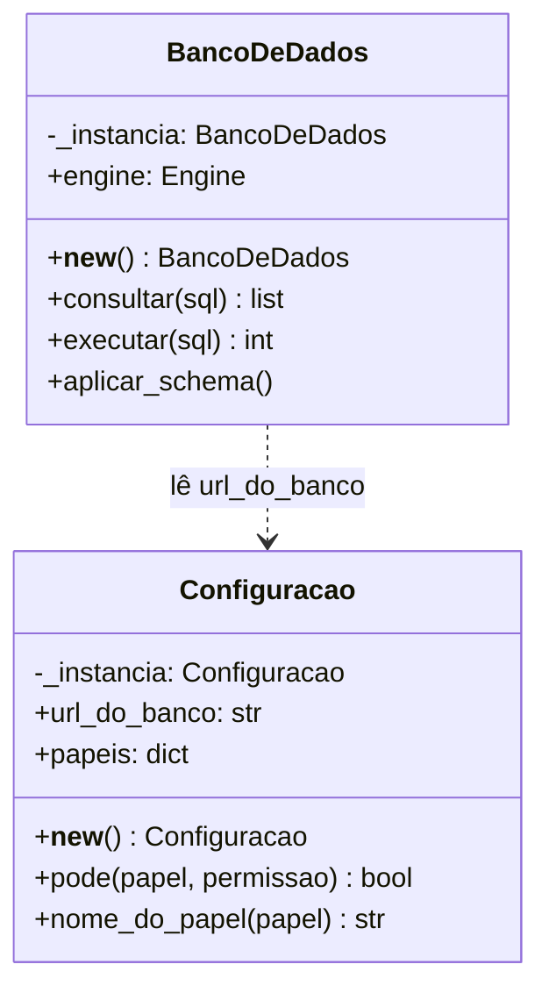
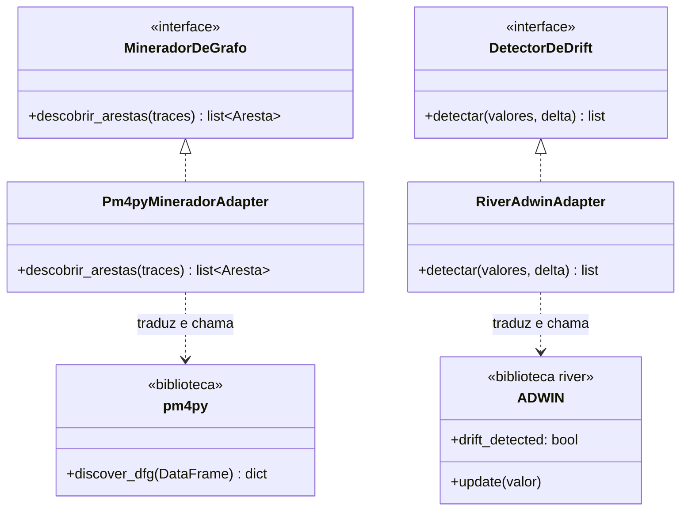
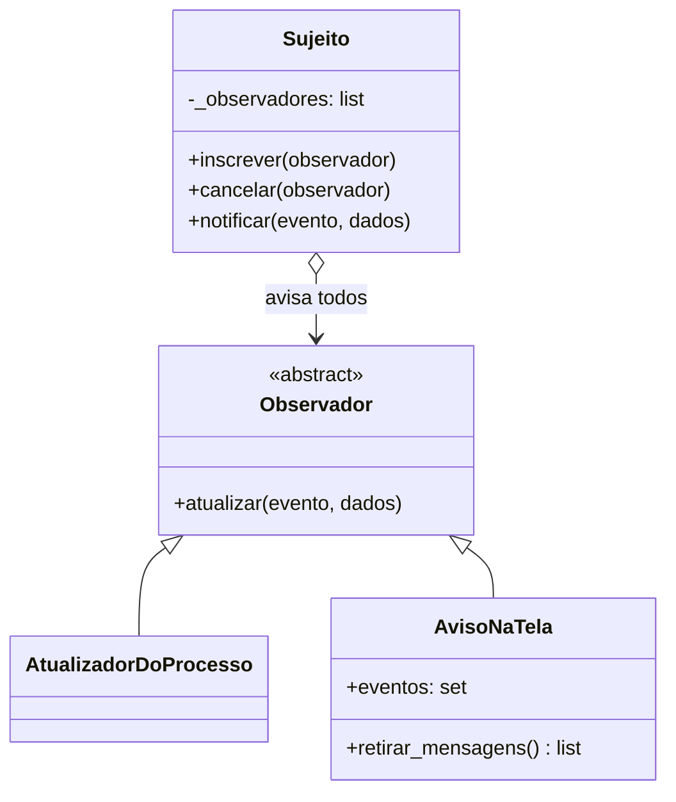

# Os três padrões de projeto (Opção 02: 3 padrões, 2 exemplos de cada)

Os dois integrantes precisam saber este arquivo inteiro. Para cada padrão: primeiro a ideia em poucas linhas, depois o desenho com as classes reais e, por fim, o código. Os links apontam para o commit `6448b13`.

| Padrão | Família | Exemplo 1 | Exemplo 2 |
|---|---|---|---|
| Singleton | criacional | `Configuracao` | `BancoDeDados` |
| Adapter | estrutural | `Pm4pyMineradorAdapter` | `RiverAdwinAdapter` |
| Observer | comportamental | análise concluída | manutenção disparada e concluída |

## 1. Singleton

**A ideia.** A classe garante que existe **um único objeto** dela no programa inteiro e dá um ponto de acesso a ele. Quem chama `Classe()` pela segunda vez recebe o mesmo objeto da primeira vez.

**Como foi feito.** O atributo de classe `_instancia` guarda o objeto. O método `__new__` (que o Python chama antes de criar qualquer objeto) só cria um objeto novo quando `_instancia` está vazio.



### 1.1 Exemplo 1: `Configuracao`

Lê o endereço do banco e as regras dos papéis uma vez só. Por isso todas as telas seguem as mesmas regras de acesso.

📍 `backend/driftor/config.py` · linhas 29–37 · [abrir no GitHub](https://github.com/aland3r/driftor-reuso/blob/6448b13/backend/driftor/config.py#L29-L37)

```python
class Configuracao:
    _instancia: Configuracao | None = None

    def __new__(cls) -> Configuracao:
        # Só cria o objeto na primeira chamada; nas outras devolve o mesmo.
        if cls._instancia is None:
            cls._instancia = super().__new__(cls)
            cls._instancia._carregar()
        return cls._instancia
```

### 1.2 Exemplo 2: `BancoDeDados`

Abre uma conexão (pool) para o app inteiro. Todos os repositórios recebem o mesmo objeto.

📍 `backend/driftor/banco.py` · linhas 20–28 · [abrir no GitHub](https://github.com/aland3r/driftor-reuso/blob/6448b13/backend/driftor/banco.py#L20-L28)

```python
class BancoDeDados:
    _instancia: BancoDeDados | None = None

    def __new__(cls) -> BancoDeDados:
        if cls._instancia is None:
            cls._instancia = super().__new__(cls)
            url = Configuracao().url_do_banco.replace("postgresql://", "postgresql+psycopg://", 1)
            cls._instancia.engine: Engine = create_engine(url, pool_pre_ping=True, connect_args={"connect_timeout": 10})
        return cls._instancia
```

**Prova:** o teste `test_singletons_devolvem_o_mesmo_objeto`, em `tests/test_cruds.py`, confere que `Configuracao() is Configuracao()` e `BancoDeDados() is BancoDeDados()`.

## 2. Adapter

**A ideia.** Faz uma classe com uma interface incompatível funcionar onde o programa espera outra interface. É como o adaptador de tomada: o programa (cliente) só conhece a **interface alvo**; o **adaptador** implementa essa interface e, por dentro, chama a biblioteca (**adaptado**) traduzindo a entrada e a saída.



### 2.1 Exemplo 1: o PM4Py vira um `MineradorDeGrafo`

O PM4Py quer uma tabela do pandas e devolve um dicionário `{(origem, destino): frequência}`. O app quer passar `Trace` e receber `Aresta`.

📍 `backend/driftor/mineracao/grafo.py` · linhas 18–48 · [abrir no GitHub](https://github.com/aland3r/driftor-reuso/blob/6448b13/backend/driftor/mineracao/grafo.py#L18-L48)

```python
class MineradorDeGrafo(ABC):
    """Interface que o app espera (o "alvo" do Adapter)."""

    @abstractmethod
    def descobrir_arestas(self, traces: list[Trace]) -> list[Aresta]: ...


class Pm4pyMineradorAdapter(MineradorDeGrafo):
    """Adaptador: implementa a interface do app usando o PM4Py por dentro."""

    def descobrir_arestas(self, traces: list[Trace]) -> list[Aresta]:
        import pm4py  # biblioteca adaptada (o "adaptado")

        # 1. Traduz Traces do domínio para a tabela que o PM4Py entende.
        linhas = [
            {
                "case_id": trace.case_id,
                "atividade": evento.nome_no_grafo(),
                "momento": pd.Timestamp("2000-01-01", tz="UTC") + pd.Timedelta(seconds=posicao),
            }
            for trace in traces
            for posicao, evento in enumerate(trace.eventos)
        ]
        if not linhas:
            return []
        # 2. Chama o PM4Py: grafo de sequência direta (DFG).
        dfg, _inicios, _fins = pm4py.discover_dfg(
            pd.DataFrame(linhas), case_id_key="case_id", activity_key="atividade", timestamp_key="momento"
        )
        # 3. Traduz a resposta do PM4Py de volta para Arestas do domínio.
        return [Aresta(origem=o, destino=d, frequencia=int(n)) for (o, d), n in dfg.items()]
```

Onde o cliente usa (só conhece a interface):

📍 `backend/driftor/processos/rotas.py` · linhas 46–46 · [abrir no GitHub](https://github.com/aland3r/driftor-reuso/blob/6448b13/backend/driftor/processos/rotas.py#L46-L46)

```python
        grafo = Grafo.montar(traces, minerador.descobrir_arestas(traces))  # Adapter em uso
```

### 2.2 Exemplo 2: o ADWIN do river vira um `DetectorDeDrift`

O ADWIN recebe um valor por vez em `update()` e liga a flag `drift_detected`. O app quer passar a série inteira e receber a lista de desvios.

📍 `backend/driftor/mineracao/detector.py` · linhas 16–36 · [abrir no GitHub](https://github.com/aland3r/driftor-reuso/blob/6448b13/backend/driftor/mineracao/detector.py#L16-L36)

```python
class DetectorDeDrift(ABC):
    """Interface que o app espera (o "alvo" do Adapter)."""

    @abstractmethod
    def detectar(self, valores: list[float], delta: float) -> list[tuple[int, int]]: ...


class RiverAdwinAdapter(DetectorDeDrift):
    """Adaptador: implementa a interface do app usando o ADWIN do river por dentro."""

    def detectar(self, valores: list[float], delta: float) -> list[tuple[int, int]]:
        adwin = ADWIN(delta=delta)  # biblioteca adaptada (o "adaptado")
        desvios: list[tuple[int, int]] = []
        inicio_do_trecho = 0
        for indice, valor in enumerate(valores):
            adwin.update(valor)
            if adwin.drift_detected:
                inicio = estimar_inicio(valores, indice, int(adwin.width), inicio_do_trecho)
                desvios.append((indice, inicio))
                inicio_do_trecho = indice + 1
        return desvios
```

Onde o cliente usa:

📍 `backend/driftor/analises/rotas.py` · linhas 49–49 · [abrir no GitHub](https://github.com/aland3r/driftor-reuso/blob/6448b13/backend/driftor/analises/rotas.py#L49-L49)

```python
    analise.registrar_resultado(valores, detector.detectar(valores, delta))  # Adapter em uso
```

**Por que é reuso.** Trocar o PM4Py ou o river por outra biblioteca exige mudar só o adaptador. Rotas, domínio e telas continuam iguais.

## 3. Observer

**A ideia.** Um objeto (o **sujeito**) mantém uma lista de **observadores** e avisa todos quando algo acontece. O sujeito não sabe o que cada observador faz. Para acrescentar uma reação nova, basta inscrever mais um observador, sem mexer em quem publica.



### 3.1 A base

📍 `backend/driftor/observador.py` · linhas 14–32 · [abrir no GitHub](https://github.com/aland3r/driftor-reuso/blob/6448b13/backend/driftor/observador.py#L14-L32)

```python
class Observador(ABC):
    @abstractmethod
    def atualizar(self, evento: str, dados: dict) -> None: ...


class Sujeito:
    def __init__(self) -> None:
        self._observadores: list[Observador] = []

    def inscrever(self, observador: Observador) -> None:
        if observador not in self._observadores:
            self._observadores.append(observador)

    def cancelar(self, observador: Observador) -> None:
        self._observadores.remove(observador)

    def notificar(self, evento: str, dados: dict) -> None:
        for observador in self._observadores:
            observador.atualizar(evento, dados)
```

### 3.2 As inscrições (quem observa o quê)

📍 `backend/driftor/main.py` · linhas 36–40 · [abrir no GitHub](https://github.com/aland3r/driftor-reuso/blob/6448b13/backend/driftor/main.py#L36-L40)

```python
# OBSERVER: quem reage a cada evento é decidido aqui, não dentro de quem publica.
publicador_de_analise.inscrever(AtualizadorDoProcesso())
publicador_de_analise.inscrever(avisos_por_papel["gestor"])
publicador_de_manutencao.inscrever(avisos_por_papel["tecnico"])  # recebe "manutencao_disparada"
publicador_de_manutencao.inscrever(avisos_por_papel["gestor"])   # recebe "manutencao_concluida"
```

### 3.3 Exemplo 1: análise concluída

Sujeito: `publicador_de_analise`. Observadores: `AtualizadorDoProcesso` (o processo sobe na lista) e a caixa de avisos do gestor (o aviso amarelo no topo).

📍 `backend/driftor/analises/eventos.py` · linhas 12–22 · [abrir no GitHub](https://github.com/aland3r/driftor-reuso/blob/6448b13/backend/driftor/analises/eventos.py#L12-L22)

```python
publicador_de_analise = Sujeito()


class AtualizadorDoProcesso(Observador):
    """Marca o processo como recém-movimentado, para ele subir na lista de processos."""

    def atualizar(self, evento: str, dados: dict) -> None:
        if evento == "analise_concluida":
            BancoDeDados().executar(
                "update processos set atualizado_em = now() where id = :id", id=dados["processo_id"]
            )
```

Quem publica:

📍 `backend/driftor/analises/rotas.py` · linhas 52–55 · [abrir no GitHub](https://github.com/aland3r/driftor-reuso/blob/6448b13/backend/driftor/analises/rotas.py#L52-L55)

```python
    publicador_de_analise.notificar("analise_concluida", {  # Observer em uso
        "processo_id": processo_id,
        "mensagem": f"Análise “{analise.nome}” concluída: {len(analise.drifts)} desvio(s) encontrado(s).",
    })
```

### 3.4 Exemplo 2: manutenção disparada e concluída

Sujeito: `publicador_de_manutencao`. Observadores: as duas caixas de `AvisoNaTela`, uma por papel. A do técnico só aceita `manutencao_disparada`, e a do gestor aceita `manutencao_concluida`.

📍 `backend/driftor/observador.py` · linhas 35–58 · [abrir no GitHub](https://github.com/aland3r/driftor-reuso/blob/6448b13/backend/driftor/observador.py#L35-L58)

```python
class AvisoNaTela(Observador):
    """Guarda o aviso que aparece no topo da próxima tela de um papel (gestor ou técnico).

    Cada caixa só aceita os eventos que interessam ao seu papel.
    """

    def __init__(self, eventos: set[str]) -> None:
        self.eventos = eventos
        self._mensagens: deque[str] = deque(maxlen=5)

    def atualizar(self, evento: str, dados: dict) -> None:
        if evento in self.eventos:
            self._mensagens.append(dados["mensagem"])

    def retirar_mensagens(self) -> list[str]:
        mensagens = list(self._mensagens)
        self._mensagens.clear()
        return mensagens


avisos_por_papel = {
    "gestor": AvisoNaTela({"analise_concluida", "manutencao_concluida"}),
    "tecnico": AvisoNaTela({"manutencao_disparada"}),
}
```

Quem publica, ao disparar (gestor) e ao concluir (técnico):

📍 `backend/driftor/manutencoes/rotas.py` · linhas 32–34 · [abrir no GitHub](https://github.com/aland3r/driftor-reuso/blob/6448b13/backend/driftor/manutencoes/rotas.py#L32-L34)

```python
    publicador_de_manutencao.notificar("manutencao_disparada", {  # Observer: avisa o técnico
        "mensagem": f"Nova manutenção: {manutencao.descricao} (análise “{analise.nome}”).",
    })
```

📍 `backend/driftor/manutencoes/rotas.py` · linhas 54–56 · [abrir no GitHub](https://github.com/aland3r/driftor-reuso/blob/6448b13/backend/driftor/manutencoes/rotas.py#L54-L56)

```python
    publicador_de_manutencao.notificar("manutencao_concluida", {  # Observer: avisa o gestor
        "mensagem": f"Manutenção concluída pelo técnico: {manutencao.descricao}.",
    })
```

**Na tela.** O aviso "Análise … concluída: 9 desvio(s) encontrado(s)." aparece para o gestor. "Nova manutenção: …" aparece para o técnico na próxima tela dele, e "Manutenção concluída pelo técnico: …" volta para o gestor.

## 4. As 13 classes principais

Ficam em `backend/driftor/dominio.py`, cada uma com atributos e métodos:

| Classe | Atributos principais | Métodos |
|---|---|---|
| `Processo` | nome, status, arquivo, total_traces | `criar`, `renomear`, `carregar_log`, `marcar_pronto`, `pode_analisar` |
| `Evento` | rotulo, inicio, duracao_s, atividade | `nome_no_grafo` |
| `Trace` | case_id, eventos | `inicio`, `sequencia`, `duracao` |
| `Atividade` | nome, descricao | `criar`, `editar` |
| `Operacao` | rotulo, ocorrencias, casos, atividade | `contar`, `sugerir_atividade`, `mapear` |
| `Variante` | numero, sequencia, total_traces | `agrupar`, `descricao` |
| `No` | atividade, frequencia, duracao_media_s | `rotulo` |
| `Aresta` | origem, destino, frequencia | (dados) |
| `Grafo` | nos, arestas | `montar`, `para_mermaid` |
| `PontoDaSerie` | posicao, case_id, valor | `serie_de_duracao` |
| `Analise` | nome, delta, tratamento, drifts | `criar`, `renomear`, `registrar_resultado` |
| `Drift` | inicio_anomalia, media_antes, media_depois | `aumentou`, `resumo` |
| `Manutencao` | analise_id, drift_id, descricao, status, observacoes | `disparar`, `esta_pendente`, `editar`, `concluir` |

Além delas: `Configuracao`, `BancoDeDados`, os quatro repositórios, `RepositorioBase`, os dois adaptadores e as classes do Observer.

## 5. A variabilidade: o que muda entre Gestor e Técnico

**A ideia.** O mesmo código serve dois perfis. Na entrada (sem senha), a pessoa escolhe Gestor ou Técnico de manutenção. O papel fica num cookie, e cada tela pergunta se aquele papel pode o que está pedindo.

| | Gestor | Técnico de manutenção |
|---|---|---|
| Começa em | Processos | Manutenções |
| Menu | Processos, Atividades, Análises, Manutenções | Manutenções |
| Análise | gera, renomeia, exclui e dispara manutenção | só vê a análise de origem |
| Manutenção | dispara, edita a descrição e exclui | executa e conclui com observações |
| Avisos (Observer) | análise concluída, manutenção concluída | manutenção nova |

**Onde estão as regras** (o Singleton `Configuracao` guarda o dicionário):

📍 `backend/driftor/config.py` · linhas 13–26 · [abrir no GitHub](https://github.com/aland3r/driftor-reuso/blob/6448b13/backend/driftor/config.py#L13-L26)

```python
PAPEIS = {
    "gestor": {
        "nome": "Gestor",
        "descricao": "Mapeia os processos, gera as análises de desvio e dispara as manutenções.",
        "inicio": "/processos",
        "pode": {"processos", "atividades", "analises", "ver_analise", "manutencoes", "disparar_manutencao"},
    },
    "tecnico": {
        "nome": "Técnico de manutenção",
        "descricao": "Recebe as manutenções disparadas, executa e registra as observações.",
        "inicio": "/manutencoes",
        "pode": {"manutencoes", "ver_analise", "concluir_manutencao"},
    },
}
```

**A entrada** grava o papel escolhido:

📍 `backend/driftor/acesso.py` · linhas 28–34 · [abrir no GitHub](https://github.com/aland3r/driftor-reuso/blob/6448b13/backend/driftor/acesso.py#L28-L34)

```python
@rotas.post("/entrar")
def entrar(papel: str = Form("")):
    if papel not in PAPEIS:
        raise ErroDeNegocio("Escolha um perfil.")
    resposta = ir_para(PAPEIS[papel]["inicio"])
    resposta.set_cookie("papel", papel, httponly=True, samesite="lax")
    return resposta
```

**A trava** em cada rota (`dependencies=[Depends(exigir("..."))]`):

📍 `backend/driftor/telas.py` · linhas 49–60 · [abrir no GitHub](https://github.com/aland3r/driftor-reuso/blob/6448b13/backend/driftor/telas.py#L49-L60)

```python
def exigir(permissao: str):
    """VARIABILIDADE: a rota só abre se o papel de quem entrou tem a permissão."""

    def verificar(request: Request) -> str:
        papel = papel_atual(request)
        if papel is None:
            raise PrecisaEntrar()
        if not Configuracao().pode(papel, permissao):
            raise SemPermissao(permissao)
        return papel

    return verificar
```

**O menu** só mostra o que o papel pode:

📍 `frontend/templates/base.html` · linhas 25–31 · [abrir no GitHub](https://github.com/aland3r/driftor-reuso/blob/6448b13/frontend/templates/base.html#L25-L31)

```jinja
    <nav class="app-nav" aria-label="Principal">
      
        
        <a href="{{ rota }}" aria-current="page">{{ rotulo }}</a>
        
      
    </nav>
```

**Prova:** o teste `test_variabilidade_por_papel`, em `tests/test_cruds.py`.
