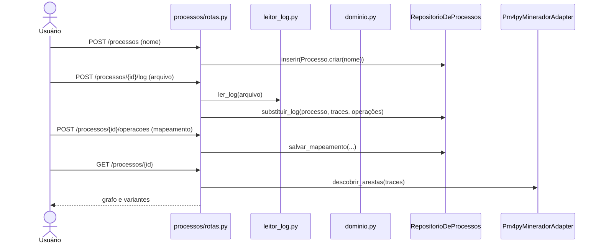

# Roteiro do Alander: Processo e Atividade

Prova de autoria da recuperação de Reuso (13/11). Os links apontam para o commit `48c729e` do repositório `driftor-reuso`.

## Antes de começar: o mapa do código

O Driftor é **um programa só** (monólito) em Python. Cada CRUD é uma pasta com `rotas.py` (tela) e `repositorio.py` (SQL). As regras ficam em `driftor/dominio.py`, e as telas em `driftor/templates/<pasta>/`.

**Meus dois CRUDs:** `driftor/processos/` (Processo) e `driftor/atividades/` (Atividade).
**Minhas tabelas:** `processos`, `eventos`, `atividades` e `operacoes`.

**Percurso na tela.** Abrir **Processos**, criar o processo, carregar o `DR_MS_ST_20.xes` (pasta `exemplos/`), mapear as operações e ver o grafo. Depois, **Atividades** no menu. Em cada CRUD, a ordem é Read, Create, Update e Delete.

## 1. As minhas tabelas

📍 `driftor/schema.sql` · linhas 4–44 · [abrir no GitHub](https://github.com/aland3r/driftor-reuso/blob/48c729e/driftor/schema.sql#L4-L44)

```sql
-- CRUD de Processo (Alander)
create table if not exists processos (
    id            uuid primary key,
    nome          text not null,
    arquivo       text,
    formato       text,
    status        text not null default 'vazio',   -- vazio | mapeando | pronto
    total_traces  integer not null default 0,
    total_eventos integer not null default 0,
    criado_em     timestamptz not null default now(),
    atualizado_em timestamptz not null default now()
);

-- Cada linha do log de eventos carregado no processo
create table if not exists eventos (
    id          bigserial primary key,
    processo_id uuid not null references processos(id) on delete cascade,
    case_id     text not null,
    ordem       integer not null,                  -- posição do evento dentro do trace
    rotulo      text not null,                     -- nome da operação como veio no log
    inicio      timestamptz,
    duracao_s   double precision
);
create index if not exists eventos_processo on eventos(processo_id, case_id, ordem);

-- CRUD de Atividade (Alander): catálogo de atividades
create table if not exists atividades (
    id        uuid primary key,
    nome      text not null,
    descricao text not null default ''
);
create unique index if not exists atividades_nome_unico on atividades (lower(nome));

-- Liga cada operação do log a uma atividade do catálogo (mapeamento)
create table if not exists operacoes (
    processo_id  uuid not null references processos(id) on delete cascade,
    rotulo       text not null,
    ocorrencias  integer not null,
    casos        integer not null,
    atividade_id uuid references atividades(id) on delete restrict,
    primary key (processo_id, rotulo)
```

> **Fala:** "Um processo tem os eventos do log. Cada operação do log aponta para uma atividade do catálogo. A atividade tem `on delete restrict`: o banco não deixa excluir uma atividade que algum processo usa."

## 2. CRUD de Processo



### 2.1 Read: a lista de processos

> **Fala:** "A tela inicial é a lista de processos, com o status e o log de cada um."

📍 `driftor/processos/rotas.py` · linhas 23–26 · [abrir no GitHub](https://github.com/aland3r/driftor-reuso/blob/48c729e/driftor/processos/rotas.py#L23-L26)

```python
# ---- Read: lista de processos (tela inicial)
@rotas.get("/processos")
def listar(request: Request):
    return tela(request, "processos/lista.html", processos=RepositorioDeProcessos().listar())
```

O `listar` é herdado de `RepositorioBase` (compactação):

📍 `driftor/repositorio_base.py` · linhas 30–33 · [abrir no GitHub](https://github.com/aland3r/driftor-reuso/blob/48c729e/driftor/repositorio_base.py#L30-L33)

```python
    # ---- Read
    def listar(self) -> list[T]:
        linhas = self.banco.consultar(f"select {self.colunas} from {self.tabela} order by {self.ordem}")
        return [self.criar_objeto(linha) for linha in linhas]
```

### 2.2 Create: criar o processo só com o nome

> **Fala:** "Escrevo 'Torno 02' e clico em Criar processo. Abre a página do processo, ainda vazio, pedindo o log."

📍 `driftor/processos/rotas.py` · linhas 29–34 · [abrir no GitHub](https://github.com/aland3r/driftor-reuso/blob/48c729e/driftor/processos/rotas.py#L29-L34)

```python
# ---- Create: só o nome; o log vem depois, na página do processo
@rotas.post("/processos")
def criar(nome: str = Form("")):
    processo = Processo.criar(nome)
    RepositorioDeProcessos().inserir(processo)
    return ir_para(f"/processos/{processo.id}")
```

📍 `driftor/processos/repositorio.py` · linhas 19–23 · [abrir no GitHub](https://github.com/aland3r/driftor-reuso/blob/48c729e/driftor/processos/repositorio.py#L19-L23)

```python
    # ---- Create
    def inserir(self, processo: Processo) -> None:
        self.banco.executar(
            "insert into processos (id, nome) values (:id, :nome)", id=processo.id, nome=processo.nome
        )
```

### 2.3 Update: carregar o log e mapear as operações

> **Fala:** "Escolho o DR_MS_ST_20.xes e clico em Carregar. A tela de operações mostra os seis rótulos do log, já com a atividade sugerida. Clico em Salvar mapeamento."

📍 `driftor/processos/rotas.py` · linhas 56–64 · [abrir no GitHub](https://github.com/aland3r/driftor-reuso/blob/48c729e/driftor/processos/rotas.py#L56-L64)

```python
# ---- Update: carregar o log de eventos no processo
@rotas.post("/processos/{id}/log")
async def carregar_log(id: str, arquivo: UploadFile = File(...)):
    repo = RepositorioDeProcessos()
    processo = repo.obter_ou_erro(id)
    formato, traces = ler_log(await arquivo.read(), arquivo.filename or "")
    processo.carregar_log(arquivo.filename or "", formato, traces)
    repo.substituir_log(processo, traces, Operacao.contar(traces))
    return ir_para(f"/processos/{id}/operacoes")
```

📍 `driftor/processos/rotas.py` · linhas 79–96 · [abrir no GitHub](https://github.com/aland3r/driftor-reuso/blob/48c729e/driftor/processos/rotas.py#L79-L96)

```python
@rotas.post("/processos/{id}/operacoes")
async def salvar_operacoes(request: Request, id: str):
    repo = RepositorioDeProcessos()
    processo = repo.obter_ou_erro(id)
    formulario = await request.form()
    atividades = RepositorioDeAtividades()
    ligacoes: dict[str, str] = {}
    for operacao in repo.operacoes(id):
        operacao.mapear(str(formulario.get(f"op::{operacao.rotulo}", "")))
        atividade = atividades.obter_por_nome(operacao.atividade)
        if atividade is None:  # nome novo entra no catálogo
            atividade = Atividade.criar(operacao.atividade)
            atividades.inserir(atividade)
        ligacoes[operacao.rotulo] = atividade.id
    repo.salvar_mapeamento(id, ligacoes)
    processo.marcar_pronto()
    repo.atualizar(processo)
    return ir_para(f"/processos/{id}")
```

### 2.4 Read: o detalhe com grafo e variantes

> **Fala:** "O processo agora está pronto. O grafo mostra as seis atividades e quantas vezes cada passagem acontece. Embaixo, as duas variantes."

📍 `driftor/processos/rotas.py` · linhas 37–53 · [abrir no GitHub](https://github.com/aland3r/driftor-reuso/blob/48c729e/driftor/processos/rotas.py#L37-L53)

```python
# ---- Read: detalhe do processo (grafo, variantes e análises)
@rotas.get("/processos/{id}")
def ver(request: Request, id: str, minerador: MineradorDeGrafo = Depends(minerador)):
    repo = RepositorioDeProcessos()
    processo = repo.obter_ou_erro(id)
    if processo.status == "mapeando":
        return ir_para(f"/processos/{id}/operacoes")
    grafo, variantes, analises, atividades = None, [], [], []
    if processo.pode_analisar():
        traces = repo.traces(id)
        grafo = Grafo.montar(traces, minerador.descobrir_arestas(traces))  # Adapter em uso
        variantes = Variante.agrupar(traces)
        atividades = [no.atividade for no in grafo.nos]
        if Configuracao().tem_recurso("analises"):
            analises = RepositorioDeAnalises().listar_resumo(processo_id=id)
    return tela(request, "processos/detalhe.html", processo=processo, grafo=grafo,
                variantes=variantes, analises=analises, atividades=atividades)
```

### 2.5 Update: renomear

📍 `driftor/processos/rotas.py` · linhas 99–106 · [abrir no GitHub](https://github.com/aland3r/driftor-reuso/blob/48c729e/driftor/processos/rotas.py#L99-L106)

```python
# ---- Update: renomear
@rotas.post("/processos/{id}/renomear")
def renomear(id: str, nome: str = Form("")):
    repo = RepositorioDeProcessos()
    processo = repo.obter_ou_erro(id)
    processo.renomear(nome)
    repo.atualizar(processo)
    return ir_para(f"/processos/{id}")
```

### 2.6 Delete

> **Fala:** "Clico em Excluir processo e confirmo. Os eventos, as operações e as análises dele somem junto, pelo `on delete cascade`."

📍 `driftor/processos/rotas.py` · linhas 109–113 · [abrir no GitHub](https://github.com/aland3r/driftor-reuso/blob/48c729e/driftor/processos/rotas.py#L109-L113)

```python
# ---- Delete
@rotas.post("/processos/{id}/excluir")
def excluir(id: str):
    RepositorioDeProcessos().excluir(id)
    return ir_para("/processos")
```

## 3. CRUD de Atividade

### 3.1 Read

> **Fala:** "No menu, Atividades. As seis atividades entraram no catálogo durante o mapeamento."

📍 `driftor/atividades/rotas.py` · linhas 14–17 · [abrir no GitHub](https://github.com/aland3r/driftor-reuso/blob/48c729e/driftor/atividades/rotas.py#L14-L17)

```python
# ---- Read
@rotas.get("/atividades")
def listar(request: Request):
    return tela(request, "atividades/lista.html", atividades=RepositorioDeAtividades().listar())
```

### 3.2 Create

> **Fala:** "Crio a atividade 'Troca de ferramenta' com uma descrição."

📍 `driftor/atividades/rotas.py` · linhas 20–24 · [abrir no GitHub](https://github.com/aland3r/driftor-reuso/blob/48c729e/driftor/atividades/rotas.py#L20-L24)

```python
# ---- Create
@rotas.post("/atividades")
def criar(nome: str = Form(""), descricao: str = Form("")):
    RepositorioDeAtividades().inserir(Atividade.criar(nome, descricao))
    return ir_para("/atividades")
```

📍 `driftor/atividades/repositorio.py` · linhas 28–36 · [abrir no GitHub](https://github.com/aland3r/driftor-reuso/blob/48c729e/driftor/atividades/repositorio.py#L28-L36)

```python
    # ---- Create
    def inserir(self, atividade: Atividade) -> None:
        try:
            self.banco.executar(
                "insert into atividades (id, nome, descricao) values (:id, :nome, :descricao)",
                id=atividade.id, nome=atividade.nome, descricao=atividade.descricao,
            )
        except IntegrityError as erro:
            raise ErroDeNegocio(f"Já existe uma atividade chamada {atividade.nome}.") from erro
```

### 3.3 Update

> **Fala:** "Clico em Editar, mudo a descrição e salvo."

📍 `driftor/atividades/rotas.py` · linhas 27–40 · [abrir no GitHub](https://github.com/aland3r/driftor-reuso/blob/48c729e/driftor/atividades/rotas.py#L27-L40)

```python
# ---- Update
@rotas.get("/atividades/{id}/editar")
def editar(request: Request, id: str):
    atividade = RepositorioDeAtividades().obter_ou_erro(id)
    return tela(request, "atividades/editar.html", atividade=atividade)


@rotas.post("/atividades/{id}")
def salvar(id: str, nome: str = Form(""), descricao: str = Form("")):
    repo = RepositorioDeAtividades()
    atividade = repo.obter_ou_erro(id)
    atividade.editar(nome, descricao)
    repo.atualizar(atividade)
    return ir_para("/atividades")
```

### 3.4 Delete

> **Fala:** "Excluo a 'Troca de ferramenta', que não é usada por nenhum processo. Depois tento excluir 'Machine_Operating': o banco recusa, porque o Torno 02 usa essa atividade."

📍 `driftor/atividades/repositorio.py` · linhas 48–53 · [abrir no GitHub](https://github.com/aland3r/driftor-reuso/blob/48c729e/driftor/atividades/repositorio.py#L48-L53)

```python
    # ---- Delete (o banco recusa se algum processo usa a atividade: on delete restrict)
    def excluir(self, id: str) -> None:
        try:
            super().excluir(id)
        except IntegrityError as erro:
            raise ErroDeNegocio("Esta atividade está mapeada em um processo e não pode ser excluída.") from erro
```

## 4. Os padrões no meu código

| Padrão | Onde eu uso |
|---|---|
| Singleton `Configuracao` | o menu e as rotas perguntam `Configuracao().tem_recurso(...)` |
| Singleton `BancoDeDados` | todos os repositórios |
| Adapter `Pm4pyMineradorAdapter` | o Read do processo chama `minerador.descobrir_arestas(traces)` |
| Variabilidade | `exigir_recurso("processos")` e `exigir_recurso("atividades")` no topo das rotas |
| Compactação | `RepositorioBase` e `templates/_componentes.html` |

## 5. Perguntas prováveis

**Onde está o Create do processo?** Em `driftor/processos/rotas.py`, na função `criar`. Ela chama `Processo.criar` (regra) e `RepositorioDeProcessos.inserir` (SQL).

**Por que o processo nasce sem log?** É o fluxo do produto: primeiro dá-se nome ao processo, depois carrega-se o log e mapeiam-se as operações.

**O que é o Adapter do PM4Py?** O app pede `descobrir_arestas(traces)` e recebe `Aresta`. O PM4Py quer uma tabela do pandas e devolve um dicionário. O `Pm4pyMineradorAdapter` traduz nos dois sentidos.

**Onde está a variabilidade?** Em `driftor/config.py`: o dicionário `EDICOES` diz quais recursos cada edição tem, e a variável `EDICAO` escolhe a edição. O mesmo código sobe como Completa (`driftor-reuso`) e como Essencial (`driftor-reuso-essencial`).

**Qual técnica de compactação?** Extração para uma superclasse genérica e para macros de template. O que os quatro repositórios repetiam (listar, obter, obter-ou-erro, excluir) foi para `RepositorioBase`. O botão de excluir, o campo de renomear e a linha de tabela vazia foram para `_componentes.html`. Antes: commit `1f77872`, depois: `c13a62b`.
