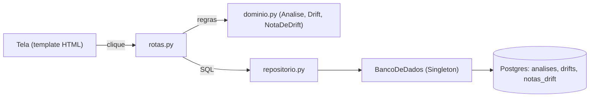
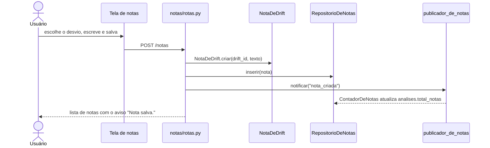

# Roteiro da Emanuelle: Análise e Nota de drift

Prova de autoria da recuperação de Reuso (13/11). Os links apontam para o commit `48c729e` do repositório `driftor-reuso`.

## Antes de começar: o mapa do código

O Driftor é **um programa só** (monólito) em Python. Cada CRUD é **uma pasta** com dois arquivos:

| Arquivo | O que faz | Pergunta do professor que ele responde |
|---|---|---|
| `rotas.py` | recebe o clique da tela e devolve a próxima tela | "onde está o Create/Read/Update/Delete?" |
| `repositorio.py` | escreve o SQL no banco | "onde conecta com o banco?" |

As regras ficam nas classes de `driftor/dominio.py`. As telas ficam em `driftor/templates/<pasta>/`.

**Meus dois CRUDs:** `driftor/analises/` (Análise) e `driftor/notas/` (Nota de drift).
**Minhas tabelas:** `analises`, `drifts` e `notas_drift`.



**Percurso na tela.** Abrir **Processos** → processo **Torno 02** (já com o log carregado e mapeado). Descer até **Gerar análise de desvios**. Depois, **Análises** no menu e **Notas dos desvios**. Em cada CRUD, a ordem é Read, Create, Update e Delete.

## 1. As minhas tabelas

📍 `driftor/schema.sql` · linhas 47–79 · [abrir no GitHub](https://github.com/aland3r/driftor-reuso/blob/48c729e/driftor/schema.sql#L47-L79)

```sql
-- CRUD de Análise (Emanuelle)
create table if not exists analises (
    id                uuid primary key,
    processo_id       uuid not null references processos(id) on delete cascade,
    nome              text not null,
    atividade         text,                        -- série filtrada por uma atividade (ou o trace inteiro)
    delta             double precision not null,
    tratamento        text not null,               -- bruto | tratado
    total_observacoes integer not null,
    total_drifts      integer not null default 0,
    total_notas       integer not null default 0,
    serie             text not null,               -- valores analisados, em JSON, para o gráfico
    criado_em         timestamptz not null default now()
);

-- Desvios que o ADWIN encontrou em cada análise
create table if not exists drifts (
    id              uuid primary key,
    analise_id      uuid not null references analises(id) on delete cascade,
    posicao         integer not null,              -- 1º, 2º, 3º desvio
    indice          integer not null,              -- trace onde o ADWIN detectou
    inicio_anomalia integer not null,              -- trace onde a mudança começou
    media_antes     double precision not null,
    media_depois    double precision not null,
    variacao_pct    double precision not null
);

-- CRUD de Nota de drift (Emanuelle)
create table if not exists notas_drift (
    id            uuid primary key,
    drift_id      uuid not null references drifts(id) on delete cascade,
    texto         text not null,
    criado_em     timestamptz not null default now(),
```

> **Fala:** "Estas são as três tabelas dos meus CRUDs. Uma análise tem vários desvios (`drifts`), e cada desvio pode ter várias notas (`notas_drift`). O `on delete cascade` faz o banco apagar os desvios e as notas quando a análise é excluída."

## 2. CRUD de Análise


### 2.1 Read: a lista de análises

> **Fala:** "No menu, clico em Análises. A tela lista todas as análises com o processo, a série e o total de desvios e de notas."

📍 `driftor/analises/rotas.py` · linhas 21–24 · [abrir no GitHub](https://github.com/aland3r/driftor-reuso/blob/48c729e/driftor/analises/rotas.py#L21-L24)

```python
# ---- Read: todas as análises
@rotas.get("/analises")
def listar(request: Request):
    return tela(request, "analises/lista.html", analises=RepositorioDeAnalises().listar_resumo())
```

📍 `driftor/analises/repositorio.py` · linhas 31–39 · [abrir no GitHub](https://github.com/aland3r/driftor-reuso/blob/48c729e/driftor/analises/repositorio.py#L31-L39)

```python
    def listar_resumo(self, processo_id: str | None = None) -> list[dict]:
        filtro = "where a.processo_id = :processo_id" if processo_id else ""
        return self.banco.consultar(
            f"""select a.id, a.nome, a.atividade, a.delta, a.tratamento, a.total_observacoes,
                       a.total_drifts, a.total_notas, a.criado_em, p.nome as processo
                from analises a join processos p on p.id = a.processo_id
                {filtro} order by a.criado_em desc""",
            processo_id=processo_id,
        )
```

### 2.2 Create: gerar a análise de desvios

> **Fala:** "Na página do processo Torno 02, escolho a série Duração de Machine_Operating, δ 0,002, tratamento Bruto, e clico em Gerar análise de desvios. A tela da análise abre com 9 desvios e um aviso amarelo no topo."

📍 `driftor/analises/rotas.py` · linhas 27–54 · [abrir no GitHub](https://github.com/aland3r/driftor-reuso/blob/48c729e/driftor/analises/rotas.py#L27-L54)

```python
# ---- Create: botão "Gerar análise de desvios" na página do processo
@rotas.post("/processos/{processo_id}/analises")
def criar(
    processo_id: str,
    nome: str = Form(""),
    atividade: str = Form(""),
    delta: float = Form(0.002),
    tratamento: str = Form("bruto"),
    detector: DetectorDeDrift = Depends(detector),
):
    processos = RepositorioDeProcessos()
    processo = processos.obter_ou_erro(processo_id)
    analise = Analise.criar(processo, nome, delta, tratamento, atividade)

    pontos = PontoDaSerie.serie_de_duracao(processos.traces(processo_id), analise.atividade)
    if len(pontos) < 2:
        raise ErroDeNegocio("A série tem menos de duas observações.")
    valores = [p.valor for p in pontos]
    if tratamento == "tratado":
        valores = suavizar(valores)
    analise.registrar_resultado(valores, detector.detectar(valores, delta))  # Adapter em uso

    RepositorioDeAnalises().inserir(analise, valores)
    publicador_de_analise.notificar("analise_concluida", {  # Observer em uso
        "processo_id": processo_id,
        "mensagem": f"Análise “{analise.nome}” concluída: {len(analise.drifts)} desvio(s) encontrado(s).",
    })
    return ir_para(f"/analises/{analise.id}")
```

Em ordem: a linha 39 valida (processo mapeado, δ entre 0 e 1). A linha 41 monta a série: uma duração por trace. A linha 47 chama o **Adapter** do ADWIN. A linha 49 grava no banco, e a linha 50 avisa os **observadores**.

O INSERT nas duas tabelas:

📍 `driftor/analises/repositorio.py` · linhas 45–60 · [abrir no GitHub](https://github.com/aland3r/driftor-reuso/blob/48c729e/driftor/analises/repositorio.py#L45-L60)

```python
    # ---- Create
    def inserir(self, analise: Analise, serie: list[float]) -> None:
        self.banco.executar(
            """insert into analises (id, processo_id, nome, atividade, delta, tratamento,
                                     total_observacoes, total_drifts, serie)
               values (:id, :processo_id, :nome, :atividade, :delta, :tratamento,
                       :total_observacoes, :total_drifts, :serie)""",
            id=analise.id, processo_id=analise.processo_id, nome=analise.nome, atividade=analise.atividade,
            delta=analise.delta, tratamento=analise.tratamento, total_observacoes=analise.total_observacoes,
            total_drifts=len(analise.drifts), serie=json.dumps(serie),
        )
        self.banco.executar_varios(
            """insert into drifts (id, analise_id, posicao, indice, inicio_anomalia, media_antes, media_depois, variacao_pct)
               values (:id, :analise_id, :posicao, :indice, :inicio_anomalia, :media_antes, :media_depois, :variacao_pct)""",
            [{**vars(d), "analise_id": analise.id} for d in analise.drifts],
        )
```

As regras da classe `Analise`:

📍 `driftor/dominio.py` · linhas 281–320 · [abrir no GitHub](https://github.com/aland3r/driftor-reuso/blob/48c729e/driftor/dominio.py#L281-L320)

```python
class Analise:
    id: str
    processo_id: str
    nome: str
    delta: float
    tratamento: str                # bruto | tratado
    atividade: str | None = None
    total_observacoes: int = 0
    drifts: list[Drift] = field(default_factory=list)

    @staticmethod
    def criar(processo: Processo, nome: str, delta: float, tratamento: str, atividade: str | None) -> Analise:
        if not processo.pode_analisar():
            raise ErroDeNegocio("Mapeie as operações do processo antes de analisar.")
        if not 0 < delta < 1:
            raise ErroDeNegocio("δ precisa estar entre 0 e 1.")
        if tratamento not in ("bruto", "tratado"):
            raise ErroDeNegocio("Tratamento deve ser 'bruto' ou 'tratado'.")
        atividade = limpar_nome(atividade) or None
        nome = limpar_nome(nome) or f"{processo.nome} · {atividade or 'trace inteiro'}"
        return Analise(novo_id(), processo.id, nome, delta, tratamento, atividade)

    def renomear(self, novo_nome: str) -> None:
        novo_nome = limpar_nome(novo_nome)
        if not novo_nome:
            raise ErroDeNegocio("O nome não pode ficar vazio.")
        self.nome = novo_nome

    def registrar_resultado(self, valores: list[float], inicios: list[tuple[int, int]]) -> None:
        """Recebe (índice da detecção, início da anomalia) de cada desvio e calcula as médias."""
        self.total_observacoes = len(valores)
        limites = [0, *[inicio for _, inicio in inicios], len(valores)]
        self.drifts = []
        for posicao, (indice, inicio) in enumerate(inicios, start=1):
            antes = valores[limites[posicao - 1]:inicio] or valores[:1]
            depois = valores[inicio:limites[posicao + 1]] or valores[-1:]
            media_antes, media_depois = statistics.fmean(antes), statistics.fmean(depois)
            variacao = (media_depois - media_antes) / abs(media_antes) * 100 if media_antes else 0.0
            self.drifts.append(
                Drift(novo_id(), posicao, indice, inicio, round(media_antes, 3), round(media_depois, 3), round(variacao, 2))
```

### 2.3 Read: o detalhe da análise

> **Fala:** "Esta é a tela da análise. O gráfico é a duração de Machine_Operating em cada trace, e cada linha vermelha é o início de um desvio. A tabela embaixo mostra a média antes e depois de cada desvio."

📍 `driftor/analises/rotas.py` · linhas 57–64 · [abrir no GitHub](https://github.com/aland3r/driftor-reuso/blob/48c729e/driftor/analises/rotas.py#L57-L64)

```python
# ---- Read: detalhe com gráfico e desvios
@rotas.get("/analises/{id}")
def ver(request: Request, id: str):
    repo = RepositorioDeAnalises()
    analise = repo.obter_ou_erro(id)
    processo = RepositorioDeProcessos().obter(analise.processo_id)
    return tela(request, "analises/detalhe.html", analise=analise, processo=processo,
                grafico=desenhar_grafico(repo.serie(id), [d.inicio_anomalia for d in analise.drifts]))
```

O `obter_ou_erro` vem da classe `RepositorioBase` (compactação). A análise já chega com os desvios:

📍 `driftor/analises/repositorio.py` · linhas 17–28 · [abrir no GitHub](https://github.com/aland3r/driftor-reuso/blob/48c729e/driftor/analises/repositorio.py#L17-L28)

```python
    def criar_objeto(self, linha: dict) -> Analise:
        """A análise vem com os seus desvios (tabela drifts)."""
        analise = Analise(**{**linha, "id": str(linha["id"]), "processo_id": str(linha["processo_id"])})
        analise.drifts = [
            Drift(**{**d, "id": str(d["id"])})
            for d in self.banco.consultar(
                """select id, posicao, indice, inicio_anomalia, media_antes, media_depois, variacao_pct
                   from drifts where analise_id = :id order by posicao""",
                id=analise.id,
            )
        ]
        return analise
```

### 2.4 Update: renomear

> **Fala:** "Troco o nome no campo do topo e clico em Renomear."

📍 `driftor/analises/rotas.py` · linhas 67–74 · [abrir no GitHub](https://github.com/aland3r/driftor-reuso/blob/48c729e/driftor/analises/rotas.py#L67-L74)

```python
# ---- Update: renomear
@rotas.post("/analises/{id}/renomear")
def renomear(id: str, nome: str = Form("")):
    repo = RepositorioDeAnalises()
    analise = repo.obter_ou_erro(id)
    analise.renomear(nome)
    repo.renomear(analise)
    return ir_para(f"/analises/{id}")
```

📍 `driftor/analises/repositorio.py` · linhas 62–63 · [abrir no GitHub](https://github.com/aland3r/driftor-reuso/blob/48c729e/driftor/analises/repositorio.py#L62-L63)

```python
    # ---- Update
    def renomear(self, analise: Analise) -> None:
```

### 2.5 Delete: excluir

> **Fala:** "Clico em Excluir análise e confirmo. Volto para o processo e a análise sumiu da lista. Os desvios e as notas dela foram apagados junto, pelo `on delete cascade`."

📍 `driftor/analises/rotas.py` · linhas 77–83 · [abrir no GitHub](https://github.com/aland3r/driftor-reuso/blob/48c729e/driftor/analises/rotas.py#L77-L83)

```python
# ---- Delete
@rotas.post("/analises/{id}/excluir")
def excluir(id: str):
    repo = RepositorioDeAnalises()
    analise = repo.obter_ou_erro(id)
    repo.excluir(id)
    return ir_para(f"/processos/{analise.processo_id}")
```

O `repo.excluir` é herdado de `RepositorioBase`:

📍 `driftor/repositorio_base.py` · linhas 45–47 · [abrir no GitHub](https://github.com/aland3r/driftor-reuso/blob/48c729e/driftor/repositorio_base.py#L45-L47)

```python
    # ---- Delete
    def excluir(self, id: str) -> None:
        self.banco.executar(f"delete from {self.tabela} where id = :id", id=id)
```

## 3. CRUD de Nota de drift



### 3.1 Read

> **Fala:** "Na análise, clico em Notas dos desvios. A tela mostra as notas de todos os desvios desta análise."

📍 `driftor/notas/rotas.py` · linhas 23–28 · [abrir no GitHub](https://github.com/aland3r/driftor-reuso/blob/48c729e/driftor/notas/rotas.py#L23-L28)

```python
# ---- Read: notas de todos os desvios de uma análise
@rotas.get("/analises/{analise_id}/notas")
def listar(request: Request, analise_id: str):
    analise = RepositorioDeAnalises().obter_ou_erro(analise_id)
    return tela(request, "notas/lista.html", analise=analise,
                notas=RepositorioDeNotas().listar_da_analise(analise_id))
```

📍 `driftor/notas/repositorio.py` · linhas 19–25 · [abrir no GitHub](https://github.com/aland3r/driftor-reuso/blob/48c729e/driftor/notas/repositorio.py#L19-L25)

```python
    def listar_da_analise(self, analise_id: str) -> list[dict]:
        return self.banco.consultar(
            """select n.id, n.drift_id, n.texto, n.atualizado_em, d.posicao
               from notas_drift n join drifts d on d.id = n.drift_id
               where d.analise_id = :analise_id order by d.posicao, n.criado_em""",
            analise_id=analise_id,
        )
```

### 3.2 Create

> **Fala:** "Escolho o Desvio 1, escrevo 'Troca do rolamento do eixo' e clico em Salvar nota. A nota aparece na lista e o aviso 'Nota salva.' aparece no topo."

📍 `driftor/notas/rotas.py` · linhas 31–38 · [abrir no GitHub](https://github.com/aland3r/driftor-reuso/blob/48c729e/driftor/notas/rotas.py#L31-L38)

```python
# ---- Create
@rotas.post("/notas")
def criar(drift_id: str = Form(""), texto: str = Form("")):
    nota = NotaDeDrift.criar(drift_id, texto)
    analise_id = _analise_do_drift(drift_id)
    RepositorioDeNotas().inserir(nota)
    publicador_de_notas.notificar("nota_criada", {"analise_id": analise_id, "mensagem": "Nota salva."})  # Observer
    return ir_para(f"/analises/{analise_id}/notas")
```

📍 `driftor/notas/repositorio.py` · linhas 27–32 · [abrir no GitHub](https://github.com/aland3r/driftor-reuso/blob/48c729e/driftor/notas/repositorio.py#L27-L32)

```python
    # ---- Create
    def inserir(self, nota: NotaDeDrift) -> None:
        self.banco.executar(
            "insert into notas_drift (id, drift_id, texto) values (:id, :drift_id, :texto)",
            id=nota.id, drift_id=nota.drift_id, texto=nota.texto,
        )
```

📍 `driftor/dominio.py` · linhas 325–335 · [abrir no GitHub](https://github.com/aland3r/driftor-reuso/blob/48c729e/driftor/dominio.py#L325-L335)

```python
class NotaDeDrift:
    id: str
    drift_id: str
    texto: str

    @staticmethod
    def criar(drift_id: str, texto: str) -> NotaDeDrift:
        texto = (texto or "").strip()
        if not texto:
            raise ErroDeNegocio("Escreva a nota antes de salvar.")
        return NotaDeDrift(novo_id(), drift_id, texto)
```

### 3.3 Update

> **Fala:** "Clico em Editar na nota, mudo o texto e salvo."

📍 `driftor/notas/rotas.py` · linhas 41–54 · [abrir no GitHub](https://github.com/aland3r/driftor-reuso/blob/48c729e/driftor/notas/rotas.py#L41-L54)

```python
# ---- Update
@rotas.get("/notas/{id}/editar")
def editar(request: Request, id: str):
    nota = RepositorioDeNotas().obter_ou_erro(id)
    return tela(request, "notas/editar.html", nota=nota, analise_id=_analise_do_drift(nota.drift_id))


@rotas.post("/notas/{id}")
def salvar(id: str, texto: str = Form("")):
    repo = RepositorioDeNotas()
    nota = repo.obter_ou_erro(id)
    nota.editar(texto)
    repo.atualizar(nota)
    return ir_para(f"/analises/{_analise_do_drift(nota.drift_id)}/notas")
```

📍 `driftor/notas/repositorio.py` · linhas 34–39 · [abrir no GitHub](https://github.com/aland3r/driftor-reuso/blob/48c729e/driftor/notas/repositorio.py#L34-L39)

```python
    # ---- Update
    def atualizar(self, nota: NotaDeDrift) -> None:
        self.banco.executar(
            "update notas_drift set texto = :texto, atualizado_em = now() where id = :id",
            id=nota.id, texto=nota.texto,
        )
```

### 3.4 Delete

> **Fala:** "Clico em Excluir na nota e confirmo. A nota sai da lista e o total de notas da análise volta a zero."

📍 `driftor/notas/rotas.py` · linhas 57–65 · [abrir no GitHub](https://github.com/aland3r/driftor-reuso/blob/48c729e/driftor/notas/rotas.py#L57-L65)

```python
# ---- Delete
@rotas.post("/notas/{id}/excluir")
def excluir(id: str):
    repo = RepositorioDeNotas()
    nota = repo.obter_ou_erro(id)
    analise_id = _analise_do_drift(nota.drift_id)
    repo.excluir(id)
    publicador_de_notas.notificar("nota_excluida", {"analise_id": analise_id, "mensagem": "Nota excluída."})  # Observer
    return ir_para(f"/analises/{analise_id}/notas")
```

## 4. Os padrões no meu código

Todos os padrões estão explicados em `defesa/padroes-de-projeto.md`. Estes três aparecem nos meus CRUDs:

| Padrão | Onde eu uso | Linha |
|---|---|---|
| Singleton `BancoDeDados` | todo repositório pega a mesma conexão | `repositorio_base.py`, `self.banco = BancoDeDados()` |
| Adapter `RiverAdwinAdapter` | o Create da análise chama `detector.detectar(...)` | `analises/rotas.py`, linha 47 |
| Observer exemplo 1 | o Create da análise chama `publicador_de_analise.notificar(...)` | `analises/rotas.py`, linha 50 |
| Observer exemplo 2 | o Create e o Delete da nota chamam `publicador_de_notas.notificar(...)` | `notas/rotas.py` |

## 5. Perguntas prováveis

**Onde está o Create da análise?** Em `driftor/analises/rotas.py`, na função `criar`. Ela grava no banco pelo `RepositorioDeAnalises.inserir`, em `driftor/analises/repositorio.py`.

**Onde conecta com o banco?** Em `driftor/banco.py`, na classe `BancoDeDados`. Os repositórios só chamam `consultar` e `executar` com o SQL.

**Por que o `BancoDeDados` é um Singleton?** Para o app inteiro usar uma conexão só (um pool). Toda vez que alguém escreve `BancoDeDados()`, o `__new__` devolve o mesmo objeto.

**O que é o Adapter aqui?** O ADWIN da biblioteca river recebe um valor por vez (`update`) e liga a flag `drift_detected`. O app quer outra coisa: passar a série inteira e receber a lista de desvios. O `RiverAdwinAdapter` faz essa tradução. Se trocar a biblioteca, só ele muda.

**O que é o Observer aqui?** O `publicador_de_analise` não sabe quem vai reagir. Em `main.py`, eu inscrevo o `AtualizadorDoProcesso` e o `AvisoNaTela`. Quando a análise termina, o `notificar` chama o `atualizar` de cada um. É o aviso amarelo que aparece no topo.

**Quantas tabelas?** São sete no total, em `driftor/schema.sql`. As minhas são `analises`, `drifts` e `notas_drift`.

**Por que a tela de análise some na edição Essencial?** Por causa da variabilidade: a edição Essencial não tem o recurso `analises`, então o `exigir_recurso("analises")` responde 404 e o menu esconde o link.

**O que acontece com as notas se eu excluir a análise?** O banco apaga os desvios e as notas junto, por causa do `on delete cascade` nas chaves estrangeiras.
