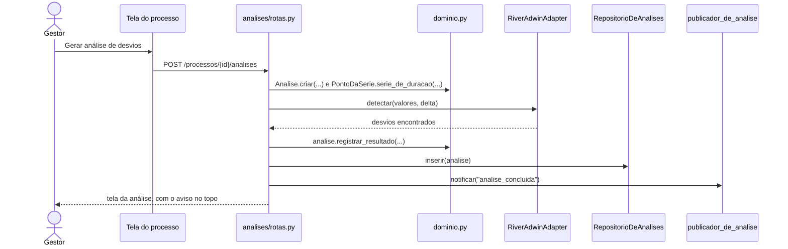
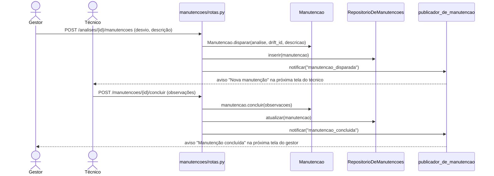

# Roteiro da Emanuelle: Análise e Manutenção

Prova de autoria da recuperação de Reuso (13/11). Os links apontam para o commit `6448b13` do repositório `driftor-reuso`.

## Antes de começar: o mapa do código

**Duas pastas no repositório:**

| Pasta | O que tem | O professor olha? |
|---|---|---|
| `backend/driftor/` | classes, regras, SQL, padrões de projeto e rotas | sim, é aqui que está tudo da avaliação |
| `frontend/` | `templates/` (HTML das telas) e `static/` (CSS) | não: só desenha a tela |

O Driftor é **um programa só** (monólito) em Python. Cada CRUD é **uma pasta** com dois arquivos:

| Arquivo | O que faz | Pergunta do professor que ele responde |
|---|---|---|
| `rotas.py` | recebe o clique da tela e devolve a próxima tela | "onde está o Create/Read/Update/Delete?" |
| `repositorio.py` | escreve o SQL no banco | "onde conecta com o banco?" |

As regras ficam nas classes de `backend/driftor/dominio.py`. As telas ficam em `frontend/templates/<pasta>/`.

**Meus dois CRUDs:** `backend/driftor/analises/` (Análise) e `backend/driftor/manutencoes/` (Manutenção).
**Minhas tabelas:** `analises`, `drifts` e `manutencoes`.


**Percurso na tela.** Entrar como **Gestor**. Abrir **Processos** → **Torno 02** (log já carregado e mapeado) e gerar a análise. Na análise, disparar a manutenção. Clicar em **Trocar perfil** e entrar como **Técnico de manutenção**: o aviso da manutenção nova aparece no topo. O técnico executa e conclui. Voltar como Gestor para ver o aviso de conclusão. Em cada CRUD, a ordem é Read, Create, Update e Delete.

## 1. As minhas tabelas

📍 `backend/driftor/schema.sql` · linhas 47–83 · [abrir no GitHub](https://github.com/aland3r/driftor-reuso/blob/6448b13/backend/driftor/schema.sql#L47-L83)

```sql
-- CRUD de Análise (Emanuelle)
create table if not exists analises (
    id                uuid primary key,
    processo_id       uuid not null references processos(id) on delete cascade,
    nome              text not null,
    atividade         text,                        -- série filtrada por uma atividade (ou o trace inteiro)
    delta             double precision not null,
    tratamento        text not null,               -- bruto | tratado
    total_observacoes integer not null,
    total_drifts      integer not null default 0,
    serie             text not null,               -- valores analisados, em JSON, para o gráfico
    criado_em         timestamptz not null default now()
);

-- Desvios que o ADWIN encontrou em cada análise
create table if not exists drifts (
    id              uuid primary key,
    analise_id      uuid not null references analises(id) on delete cascade,
    posicao         integer not null,              -- 1º, 2º, 3º desvio
    indice          integer not null,              -- trace onde o ADWIN detectou
    inicio_anomalia integer not null,              -- trace onde a mudança começou
    media_antes     double precision not null,
    media_depois    double precision not null,
    variacao_pct    double precision not null
);

-- CRUD de Manutenção (Emanuelle): o gestor dispara a partir de um desvio, o técnico conclui
create table if not exists manutencoes (
    id           uuid primary key,
    analise_id   uuid not null references analises(id) on delete cascade,
    drift_id     uuid references drifts(id) on delete set null,
    descricao    text not null,
    status       text not null default 'pendente',   -- pendente | concluida
    observacoes  text not null default '',
    criado_em    timestamptz not null default now(),
    concluida_em timestamptz
);
```

> **Fala:** "Estas são as três tabelas dos meus CRUDs. Uma análise tem vários desvios (`drifts`). A manutenção aponta para a análise e para o desvio que a motivou, e guarda o status e as observações do técnico. Se a análise for excluída, o `on delete cascade` apaga os desvios e as manutenções dela."

## 2. CRUD de Análise (só o Gestor)



### 2.1 Read: a lista de análises

> **Fala:** "No menu, clico em Análises. A tela lista as análises com o processo, a série e o total de desvios."

📍 `backend/driftor/analises/rotas.py` · linhas 23–26 · [abrir no GitHub](https://github.com/aland3r/driftor-reuso/blob/6448b13/backend/driftor/analises/rotas.py#L23-L26)

```python
# ---- Read: todas as análises
@rotas.get("/analises", dependencies=so_gestor)
def listar(request: Request):
    return tela(request, "analises/lista.html", analises=RepositorioDeAnalises().listar_resumo())
```

📍 `backend/driftor/analises/repositorio.py` · linhas 31–39 · [abrir no GitHub](https://github.com/aland3r/driftor-reuso/blob/6448b13/backend/driftor/analises/repositorio.py#L31-L39)

```python
    def listar_resumo(self, processo_id: str | None = None) -> list[dict]:
        filtro = "where a.processo_id = :processo_id" if processo_id else ""
        return self.banco.consultar(
            f"""select a.id, a.nome, a.atividade, a.delta, a.tratamento, a.total_observacoes,
                       a.total_drifts, a.criado_em, p.nome as processo
                from analises a join processos p on p.id = a.processo_id
                {filtro} order by a.criado_em desc""",
            processo_id=processo_id,
        )
```

### 2.2 Create: gerar a análise de desvios

> **Fala:** "Na página do processo Torno 02, escolho a série Duração de Machine_Operating, δ 0,002, tratamento Bruto, e clico em Gerar análise de desvios. A tela da análise abre com 9 desvios e o aviso amarelo no topo."

📍 `backend/driftor/analises/rotas.py` · linhas 29–56 · [abrir no GitHub](https://github.com/aland3r/driftor-reuso/blob/6448b13/backend/driftor/analises/rotas.py#L29-L56)

```python
# ---- Create: botão "Gerar análise de desvios" na página do processo
@rotas.post("/processos/{processo_id}/analises", dependencies=so_gestor)
def criar(
    processo_id: str,
    nome: str = Form(""),
    atividade: str = Form(""),
    delta: float = Form(0.002),
    tratamento: str = Form("bruto"),
    detector: DetectorDeDrift = Depends(detector),
):
    processos = RepositorioDeProcessos()
    processo = processos.obter_ou_erro(processo_id)
    analise = Analise.criar(processo, nome, delta, tratamento, atividade)

    pontos = PontoDaSerie.serie_de_duracao(processos.traces(processo_id), analise.atividade)
    if len(pontos) < 2:
        raise ErroDeNegocio("A série tem menos de duas observações.")
    valores = [p.valor for p in pontos]
    if tratamento == "tratado":
        valores = suavizar(valores)
    analise.registrar_resultado(valores, detector.detectar(valores, delta))  # Adapter em uso

    RepositorioDeAnalises().inserir(analise, valores)
    publicador_de_analise.notificar("analise_concluida", {  # Observer em uso
        "processo_id": processo_id,
        "mensagem": f"Análise “{analise.nome}” concluída: {len(analise.drifts)} desvio(s) encontrado(s).",
    })
    return ir_para(f"/analises/{analise.id}")
```

Em ordem: valida o processo e o δ, monta a série (uma duração por trace), chama o **Adapter** do ADWIN (`detector().detectar`), grava no banco e avisa os **observadores** (`publicador_de_analise.notificar`).

O INSERT nas duas tabelas:

📍 `backend/driftor/analises/repositorio.py` · linhas 45–60 · [abrir no GitHub](https://github.com/aland3r/driftor-reuso/blob/6448b13/backend/driftor/analises/repositorio.py#L45-L60)

```python
    # ---- Create
    def inserir(self, analise: Analise, serie: list[float]) -> None:
        self.banco.executar(
            """insert into analises (id, processo_id, nome, atividade, delta, tratamento,
                                     total_observacoes, total_drifts, serie)
               values (:id, :processo_id, :nome, :atividade, :delta, :tratamento,
                       :total_observacoes, :total_drifts, :serie)""",
            id=analise.id, processo_id=analise.processo_id, nome=analise.nome, atividade=analise.atividade,
            delta=analise.delta, tratamento=analise.tratamento, total_observacoes=analise.total_observacoes,
            total_drifts=len(analise.drifts), serie=json.dumps(serie),
        )
        self.banco.executar_varios(
            """insert into drifts (id, analise_id, posicao, indice, inicio_anomalia, media_antes, media_depois, variacao_pct)
               values (:id, :analise_id, :posicao, :indice, :inicio_anomalia, :media_antes, :media_depois, :variacao_pct)""",
            [{**vars(d), "analise_id": analise.id} for d in analise.drifts],
        )
```

As regras da classe `Analise`:

📍 `backend/driftor/dominio.py` · linhas 281–320 · [abrir no GitHub](https://github.com/aland3r/driftor-reuso/blob/6448b13/backend/driftor/dominio.py#L281-L320)

```python
class Analise:
    id: str
    processo_id: str
    nome: str
    delta: float
    tratamento: str                # bruto | tratado
    atividade: str | None = None
    total_observacoes: int = 0
    drifts: list[Drift] = field(default_factory=list)

    @staticmethod
    def criar(processo: Processo, nome: str, delta: float, tratamento: str, atividade: str | None) -> Analise:
        if not processo.pode_analisar():
            raise ErroDeNegocio("Mapeie as operações do processo antes de analisar.")
        if not 0 < delta < 1:
            raise ErroDeNegocio("δ precisa estar entre 0 e 1.")
        if tratamento not in ("bruto", "tratado"):
            raise ErroDeNegocio("Tratamento deve ser 'bruto' ou 'tratado'.")
        atividade = limpar_nome(atividade) or None
        nome = limpar_nome(nome) or f"{processo.nome} · {atividade or 'trace inteiro'}"
        return Analise(novo_id(), processo.id, nome, delta, tratamento, atividade)

    def renomear(self, novo_nome: str) -> None:
        novo_nome = limpar_nome(novo_nome)
        if not novo_nome:
            raise ErroDeNegocio("O nome não pode ficar vazio.")
        self.nome = novo_nome

    def registrar_resultado(self, valores: list[float], inicios: list[tuple[int, int]]) -> None:
        """Recebe (índice da detecção, início da anomalia) de cada desvio e calcula as médias."""
        self.total_observacoes = len(valores)
        limites = [0, *[inicio for _, inicio in inicios], len(valores)]
        self.drifts = []
        for posicao, (indice, inicio) in enumerate(inicios, start=1):
            antes = valores[limites[posicao - 1]:inicio] or valores[:1]
            depois = valores[inicio:limites[posicao + 1]] or valores[-1:]
            media_antes, media_depois = statistics.fmean(antes), statistics.fmean(depois)
            variacao = (media_depois - media_antes) / abs(media_antes) * 100 if media_antes else 0.0
            self.drifts.append(
                Drift(novo_id(), posicao, indice, inicio, round(media_antes, 3), round(media_depois, 3), round(variacao, 2))
```

### 2.3 Read: o detalhe da análise

> **Fala:** "O gráfico é a duração de Machine_Operating em cada trace, e cada linha vermelha é o início de um desvio. A tabela mostra a média antes e depois de cada desvio. Embaixo ficam o formulário de disparar manutenção e as manutenções desta análise."

📍 `backend/driftor/analises/rotas.py` · linhas 59–67 · [abrir no GitHub](https://github.com/aland3r/driftor-reuso/blob/6448b13/backend/driftor/analises/rotas.py#L59-L67)

```python
# ---- Read: detalhe com gráfico e desvios (o técnico também vê, sem editar)
@rotas.get("/analises/{id}", dependencies=[Depends(exigir("ver_analise"))])
def ver(request: Request, id: str):
    repo = RepositorioDeAnalises()
    analise = repo.obter_ou_erro(id)
    processo = RepositorioDeProcessos().obter(analise.processo_id)
    manutencoes = RepositorioDeManutencoes().listar_resumo(analise_id=id)
    return tela(request, "analises/detalhe.html", analise=analise, processo=processo, manutencoes=manutencoes,
                grafico=desenhar_grafico(repo.serie(id), [d.inicio_anomalia for d in analise.drifts]))
```

O `obter_ou_erro` vem da classe `RepositorioBase` (compactação). A análise já chega com os desvios:

📍 `backend/driftor/analises/repositorio.py` · linhas 17–28 · [abrir no GitHub](https://github.com/aland3r/driftor-reuso/blob/6448b13/backend/driftor/analises/repositorio.py#L17-L28)

```python
    def criar_objeto(self, linha: dict) -> Analise:
        """A análise vem com os seus desvios (tabela drifts)."""
        analise = Analise(**{**linha, "id": str(linha["id"]), "processo_id": str(linha["processo_id"])})
        analise.drifts = [
            Drift(**{**d, "id": str(d["id"])})
            for d in self.banco.consultar(
                """select id, posicao, indice, inicio_anomalia, media_antes, media_depois, variacao_pct
                   from drifts where analise_id = :id order by posicao""",
                id=analise.id,
            )
        ]
        return analise
```

### 2.4 Update: renomear

> **Fala:** "Troco o nome no campo do topo e clico em Renomear."

📍 `backend/driftor/analises/rotas.py` · linhas 70–77 · [abrir no GitHub](https://github.com/aland3r/driftor-reuso/blob/6448b13/backend/driftor/analises/rotas.py#L70-L77)

```python
# ---- Update: renomear
@rotas.post("/analises/{id}/renomear", dependencies=so_gestor)
def renomear(id: str, nome: str = Form("")):
    repo = RepositorioDeAnalises()
    analise = repo.obter_ou_erro(id)
    analise.renomear(nome)
    repo.renomear(analise)
    return ir_para(f"/analises/{id}")
```

📍 `backend/driftor/analises/repositorio.py` · linhas 62–63 · [abrir no GitHub](https://github.com/aland3r/driftor-reuso/blob/6448b13/backend/driftor/analises/repositorio.py#L62-L63)

```python
    # ---- Update
    def renomear(self, analise: Analise) -> None:
```

### 2.5 Delete: excluir

> **Fala:** "Clico em Excluir análise e confirmo. Volto para o processo e a análise sumiu. Os desvios e as manutenções dela foram apagados junto, pelo `on delete cascade`."

📍 `backend/driftor/analises/rotas.py` · linhas 80–86 · [abrir no GitHub](https://github.com/aland3r/driftor-reuso/blob/6448b13/backend/driftor/analises/rotas.py#L80-L86)

```python
# ---- Delete
@rotas.post("/analises/{id}/excluir", dependencies=so_gestor)
def excluir(id: str):
    repo = RepositorioDeAnalises()
    analise = repo.obter_ou_erro(id)
    repo.excluir(id)
    return ir_para(f"/processos/{analise.processo_id}")
```

O `repo.excluir` é herdado de `RepositorioBase`:

📍 `backend/driftor/repositorio_base.py` · linhas 45–47 · [abrir no GitHub](https://github.com/aland3r/driftor-reuso/blob/6448b13/backend/driftor/repositorio_base.py#L45-L47)

```python
    # ---- Delete
    def excluir(self, id: str) -> None:
        self.banco.executar(f"delete from {self.tabela} where id = :id", id=id)
```

## 3. CRUD de Manutenção (Gestor dispara, Técnico conclui)



### 3.1 Create: o gestor dispara a manutenção

> **Fala:** "Ainda como Gestor, na análise, escolho o Desvio 1, escrevo 'Verificar rolamento do eixo' e clico em Disparar manutenção. Ela aparece embaixo, em Manutenções desta análise, como pendente."

📍 `backend/driftor/manutencoes/rotas.py` · linhas 26–35 · [abrir no GitHub](https://github.com/aland3r/driftor-reuso/blob/6448b13/backend/driftor/manutencoes/rotas.py#L26-L35)

```python
# ---- Create: o gestor dispara a manutenção na tela da análise
@rotas.post("/analises/{analise_id}/manutencoes", dependencies=[Depends(exigir("disparar_manutencao"))])
def disparar(analise_id: str, drift_id: str = Form(""), descricao: str = Form("")):
    analise = RepositorioDeAnalises().obter_ou_erro(analise_id)
    manutencao = Manutencao.disparar(analise, drift_id, descricao)
    RepositorioDeManutencoes().inserir(manutencao)
    publicador_de_manutencao.notificar("manutencao_disparada", {  # Observer: avisa o técnico
        "mensagem": f"Nova manutenção: {manutencao.descricao} (análise “{analise.nome}”).",
    })
    return ir_para(f"/analises/{analise_id}")
```

A regra fica na classe `Manutencao`: o desvio precisa ser desta análise e a descrição não pode ser vazia.

📍 `backend/driftor/dominio.py` · linhas 325–344 · [abrir no GitHub](https://github.com/aland3r/driftor-reuso/blob/6448b13/backend/driftor/dominio.py#L325-L344)

```python
class Manutencao:
    """Ordem de manutenção que o gestor dispara a partir de um desvio e o técnico conclui."""

    id: str
    analise_id: str
    drift_id: str | None
    descricao: str
    status: str = "pendente"       # pendente -> concluida
    observacoes: str = ""
    criado_em: datetime | None = None
    concluida_em: datetime | None = None

    @staticmethod
    def disparar(analise: Analise, drift_id: str | None, descricao: str) -> Manutencao:
        if drift_id and drift_id not in {d.id for d in analise.drifts}:
            raise ErroDeNegocio("Este desvio não pertence à análise.")
        descricao = (descricao or "").strip()
        if not descricao:
            raise ErroDeNegocio("Descreva o que o técnico deve verificar.")
        return Manutencao(novo_id(), analise.id, drift_id or None, descricao)
```

📍 `backend/driftor/manutencoes/repositorio.py` · linhas 41–48 · [abrir no GitHub](https://github.com/aland3r/driftor-reuso/blob/6448b13/backend/driftor/manutencoes/repositorio.py#L41-L48)

```python
    # ---- Create
    def inserir(self, manutencao: Manutencao) -> None:
        self.banco.executar(
            """insert into manutencoes (id, analise_id, drift_id, descricao)
               values (:id, :analise_id, :drift_id, :descricao)""",
            id=manutencao.id, analise_id=manutencao.analise_id,
            drift_id=manutencao.drift_id, descricao=manutencao.descricao,
        )
```

### 3.2 Read: o técnico vê a manutenção

> **Fala:** "Clico em Trocar perfil e entro como Técnico de manutenção. O menu agora só tem Manutenções, e o aviso 'Nova manutenção: Verificar rolamento do eixo' aparece no topo. A lista mostra a manutenção pendente."

📍 `backend/driftor/manutencoes/rotas.py` · linhas 20–23 · [abrir no GitHub](https://github.com/aland3r/driftor-reuso/blob/6448b13/backend/driftor/manutencoes/rotas.py#L20-L23)

```python
# ---- Read: lista (gestor e técnico)
@rotas.get("/manutencoes", dependencies=[Depends(exigir("manutencoes"))])
def listar(request: Request):
    return tela(request, "manutencoes/lista.html", manutencoes=RepositorioDeManutencoes().listar_resumo())
```

📍 `backend/driftor/manutencoes/repositorio.py` · linhas 23–36 · [abrir no GitHub](https://github.com/aland3r/driftor-reuso/blob/6448b13/backend/driftor/manutencoes/repositorio.py#L23-L36)

```python
    # ---- Read: a lista com o nome da análise, do processo e o número do desvio
    def listar_resumo(self, analise_id: str | None = None) -> list[dict]:
        filtro = "where m.analise_id = :analise_id" if analise_id else ""
        return self.banco.consultar(
            f"""select m.id, m.descricao, m.status, m.observacoes, m.criado_em, m.concluida_em,
                       a.id as analise_id, a.nome as analise, p.nome as processo, d.posicao as desvio
                from manutencoes m
                join analises a on a.id = m.analise_id
                join processos p on p.id = a.processo_id
                left join drifts d on d.id = m.drift_id
                {filtro}
                order by (m.status = 'pendente') desc, m.criado_em desc""",
            analise_id=analise_id,
        )
```

> **Fala:** "Clico em Executar. A tela mostra o desvio que motivou a manutenção e o link para a análise de origem."

📍 `backend/driftor/manutencoes/rotas.py` · linhas 38–44 · [abrir no GitHub](https://github.com/aland3r/driftor-reuso/blob/6448b13/backend/driftor/manutencoes/rotas.py#L38-L44)

```python
# ---- Read: detalhe (gestor e técnico)
@rotas.get("/manutencoes/{id}", dependencies=[Depends(exigir("manutencoes"))])
def ver(request: Request, id: str):
    manutencao = RepositorioDeManutencoes().obter_ou_erro(id)
    analise = RepositorioDeAnalises().obter_ou_erro(manutencao.analise_id)
    drift = next((d for d in analise.drifts if d.id == manutencao.drift_id), None)
    return tela(request, "manutencoes/detalhe.html", manutencao=manutencao, analise=analise, drift=drift)
```

### 3.3 Update: o técnico conclui com observações

> **Fala:** "Escrevo 'Rolamento trocado e folga ajustada' e clico em Concluir manutenção. Na lista, o status muda para concluída."

📍 `backend/driftor/manutencoes/rotas.py` · linhas 47–57 · [abrir no GitHub](https://github.com/aland3r/driftor-reuso/blob/6448b13/backend/driftor/manutencoes/rotas.py#L47-L57)

```python
# ---- Update pelo técnico: concluir com observações
@rotas.post("/manutencoes/{id}/concluir", dependencies=[Depends(exigir("concluir_manutencao"))])
def concluir(id: str, observacoes: str = Form("")):
    repo = RepositorioDeManutencoes()
    manutencao = repo.obter_ou_erro(id)
    manutencao.concluir(observacoes)
    repo.atualizar(manutencao)
    publicador_de_manutencao.notificar("manutencao_concluida", {  # Observer: avisa o gestor
        "mensagem": f"Manutenção concluída pelo técnico: {manutencao.descricao}.",
    })
    return ir_para("/manutencoes")
```

📍 `backend/driftor/dominio.py` · linhas 357–364 · [abrir no GitHub](https://github.com/aland3r/driftor-reuso/blob/6448b13/backend/driftor/dominio.py#L357-L364)

```python
    def concluir(self, observacoes: str) -> None:
        if not self.esta_pendente():
            raise ErroDeNegocio("Esta manutenção já foi concluída.")
        observacoes = (observacoes or "").strip()
        if not observacoes:
            raise ErroDeNegocio("Escreva as observações do que foi feito.")
        self.status = "concluida"
        self.observacoes = observacoes
```

📍 `backend/driftor/manutencoes/repositorio.py` · linhas 50–58 · [abrir no GitHub](https://github.com/aland3r/driftor-reuso/blob/6448b13/backend/driftor/manutencoes/repositorio.py#L50-L58)

```python
    # ---- Update (o gestor edita a descrição; o técnico conclui com observações)
    def atualizar(self, manutencao: Manutencao) -> None:
        self.banco.executar(
            """update manutencoes set descricao = :descricao, status = :status, observacoes = :observacoes,
                   concluida_em = case when :status = 'concluida' then coalesce(concluida_em, now()) end
               where id = :id""",
            id=manutencao.id, descricao=manutencao.descricao,
            status=manutencao.status, observacoes=manutencao.observacoes,
        )
```

O gestor também tem um Update: ele corrige a descrição enquanto a manutenção está pendente.

📍 `backend/driftor/manutencoes/rotas.py` · linhas 60–67 · [abrir no GitHub](https://github.com/aland3r/driftor-reuso/blob/6448b13/backend/driftor/manutencoes/rotas.py#L60-L67)

```python
# ---- Update pelo gestor: corrigir a descrição enquanto está pendente
@rotas.post("/manutencoes/{id}", dependencies=[Depends(exigir("disparar_manutencao"))])
def editar(id: str, descricao: str = Form("")):
    repo = RepositorioDeManutencoes()
    manutencao = repo.obter_ou_erro(id)
    manutencao.editar(descricao)
    repo.atualizar(manutencao)
    return ir_para(f"/manutencoes/{id}")
```

### 3.4 Delete: só o gestor

> **Fala:** "Volto como Gestor. O aviso 'Manutenção concluída pelo técnico' aparece no topo. Em Manutenções, abro uma manutenção e clico em Excluir. O técnico não tem esse botão."

📍 `backend/driftor/manutencoes/rotas.py` · linhas 70–74 · [abrir no GitHub](https://github.com/aland3r/driftor-reuso/blob/6448b13/backend/driftor/manutencoes/rotas.py#L70-L74)

```python
# ---- Delete pelo gestor
@rotas.post("/manutencoes/{id}/excluir", dependencies=[Depends(exigir("disparar_manutencao"))])
def excluir(id: str):
    RepositorioDeManutencoes().excluir(id)
    return ir_para("/manutencoes")
```

## 4. A variabilidade aparece no meu CRUD

A mesma tela de manutenção muda conforme o papel. Cada rota diz qual permissão exige, e o `PAPEIS` diz quem tem cada uma:

| Ação | Permissão | Gestor | Técnico |
|---|---|---|---|
| Ver a lista e o detalhe | `manutencoes` | sim | sim |
| Disparar, editar a descrição, excluir | `disparar_manutencao` | sim | não |
| Concluir com observações | `concluir_manutencao` | não | sim |
| Ver a análise de origem | `ver_analise` | sim | sim, sem renomear, excluir nem disparar |

📍 `backend/driftor/config.py` · linhas 13–26 · [abrir no GitHub](https://github.com/aland3r/driftor-reuso/blob/6448b13/backend/driftor/config.py#L13-L26)

```python
PAPEIS = {
    "gestor": {
        "nome": "Gestor",
        "descricao": "Mapeia os processos, gera as análises de desvio e dispara as manutenções.",
        "inicio": "/processos",
        "pode": {"processos", "atividades", "analises", "ver_analise", "manutencoes", "disparar_manutencao"},
    },
    "tecnico": {
        "nome": "Técnico de manutenção",
        "descricao": "Recebe as manutenções disparadas, executa e registra as observações.",
        "inicio": "/manutencoes",
        "pode": {"manutencoes", "ver_analise", "concluir_manutencao"},
    },
}
```

## 5. Os padrões no meu código

Todos os padrões estão explicados em `defesa/padroes-de-projeto.md`. Estes aparecem nos meus CRUDs:

| Padrão | Onde eu uso |
|---|---|
| Singleton `BancoDeDados` | todo repositório pega a mesma conexão (`self.banco = BancoDeDados()` em `repositorio_base.py`) |
| Singleton `Configuracao` | `exigir(...)` pergunta `Configuracao().pode(papel, permissao)` antes de abrir a rota |
| Adapter `RiverAdwinAdapter` | o Create da análise chama `detector().detectar(...)` |
| Observer exemplo 1 | o Create da análise chama `publicador_de_analise.notificar("analise_concluida", ...)` |
| Observer exemplo 2 | o Create e o Update da manutenção chamam `publicador_de_manutencao.notificar(...)` |

## 6. Perguntas prováveis

**Onde está o Create da manutenção?** Em `backend/driftor/manutencoes/rotas.py`, na função `disparar`. Ela usa a regra `Manutencao.disparar` (em `dominio.py`) e grava pelo `RepositorioDeManutencoes.inserir`.

**Onde conecta com o banco?** Em `backend/driftor/banco.py`, na classe `BancoDeDados`. Os repositórios só chamam `consultar` e `executar` com o SQL.

**Por que o `BancoDeDados` é um Singleton?** Para o app inteiro usar uma conexão só (um pool). Toda vez que alguém escreve `BancoDeDados()`, o `__new__` devolve o mesmo objeto.

**O que é o Adapter aqui?** O ADWIN da biblioteca river recebe um valor por vez (`update`) e liga a flag `drift_detected`. O app quer passar a série inteira e receber a lista de desvios. O `RiverAdwinAdapter` faz essa tradução. Se trocar a biblioteca, só ele muda.

**Como o técnico fica sabendo da manutenção?** Pelo Observer. Quando o gestor dispara, a rota chama `publicador_de_manutencao.notificar("manutencao_disparada", ...)`. Em `main.py`, a caixa de avisos do técnico está inscrita nesse publicador. Ela guarda a mensagem, e a próxima tela do técnico mostra o aviso no topo. Quem dispara não sabe quem vai receber.

**Por que o gestor não recebe o aviso de "Nova manutenção"?** Cada `AvisoNaTela` só aceita os eventos do seu papel: a do técnico aceita `manutencao_disparada`, e a do gestor aceita `analise_concluida` e `manutencao_concluida`. Está em `backend/driftor/observador.py`, no `avisos_por_papel`.

**Onde está a variabilidade?** No papel. `PAPEIS`, em `backend/driftor/config.py`, lista as permissões do Gestor e do Técnico. Cada rota tem `exigir("...")`, de `backend/driftor/telas.py`. Se o técnico tentar abrir `/analises` pelo endereço, recebe 403.

**O que acontece com as manutenções se eu excluir a análise?** O banco apaga os desvios e as manutenções junto, por causa do `on delete cascade`.

**Dá para concluir sem observações?** Não. `Manutencao.concluir` recusa observações vazias e recusa concluir de novo uma manutenção já concluída. O erro aparece numa tela própria (422).
